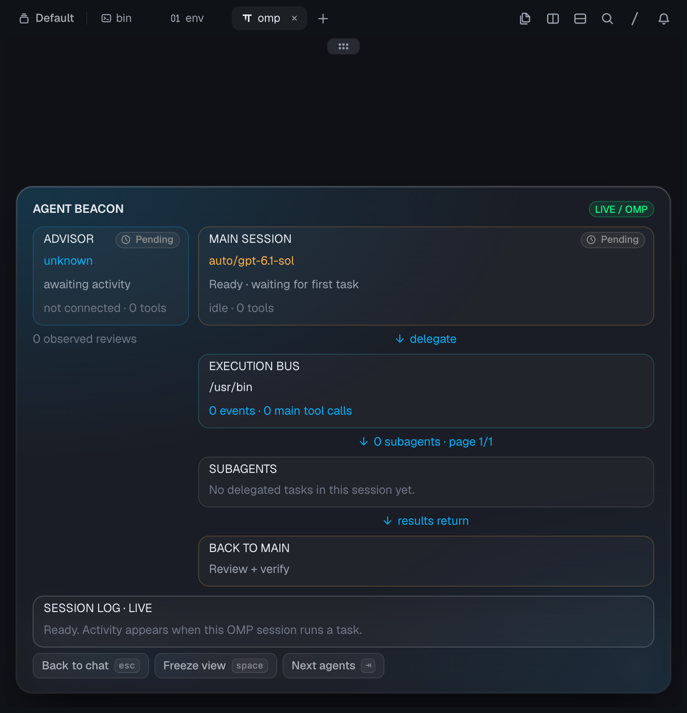

# Agent Beacon

[](https://github.com/njiangk/omp-agent-beacon/actions/workflows/ci.yml)
[](LICENSE)
[](https://github.com/njiangk/omp-agent-beacon/releases)



## English

Agent Beacon draws a live diagram of an [oh-my-pi](https://github.com/can1357/oh-my-pi) (`omp`) session: the main model, its subagents, advisor reviews, tool activity, and the tokens/cost each agent used. It reads session JSONL files only; it never calls a model.

**What it is for** — `omp stats` answers "what have I spent?" with a historical web dashboard. Agent Beacon answers "what is happening right now?": which subagent is on which task, whether the advisor is being consulted, what each node has cost so far, and where the main model is blocked. It opens over the chat with `/beacon`, needs no server, and adds no hooks.

Requirements: `omp` 18+, Python 3.9+, macOS or Linux. Windows can render `--snapshot`. Interactive mode, `--frames`, and therefore the `/beacon` overlay need a POSIX terminal; a pipe-reading thread is not implemented yet. The native card view is provided by omp/Tern; any color terminal gets the character rendering.

Install as an omp plugin:

```sh
omp plugin marketplace add njiangk/omp-agent-beacon
omp plugin install agent-beacon@omp-agent-beacon
```

Restart omp once, then:

```text
/beacon         this session
/beacon demo    synthetic animation
```

Standalone renderer:

```sh
python3 beacon.py --omp      # newest omp session
python3 beacon.py --demo
python3 beacon.py --claude
python3 beacon.py --events events.jsonl
```

Keys: `q` quit, `space` pause motion, `tab` page through subagents, `r` clear the visible log. Recommended 110×48; minimum 86×44.

Usage numbers come from the logs. OMP assistant messages record per-response `usage`; the panel sums tokens and, when present, the logged cost. Claude Code logs carry tokens but no price, so only tokens are shown. Nothing is estimated locally.

The renderer only reads `~/.omp/agent/sessions` or `~/.claude/projects`; installing the plugin adds no hooks, network calls, or model requests. Not affiliated with the omp project.

## 中文

参考终端流程图风格的本地 TUI。Python 3.9+，无第三方依赖。建议使用真彩色终端，110 列 × 48 行；最小 86 列 × 44 行。普通终端无法绘制模糊辉光，本程序用颜色、粗细线和流动字符表现活跃路径。

## 安装（omp 插件）

```sh
omp plugin marketplace add njiangk/omp-agent-beacon
omp plugin install agent-beacon@omp-agent-beacon
```

重启一次 omp 后即可使用 `/beacon`。也可以直接把本仓库作为扩展加载：

```sh
omp --extension /path/to/omp-agent-beacon/omp-extension.ts
```

## 启动

在仓库目录内运行：

```sh
python3 beacon.py --demo
python3 beacon.py --omp
python3 beacon.py --omp /path/to/omp-session.jsonl
python3 beacon.py --claude
python3 beacon.py --claude /path/to/session.jsonl
python3 beacon.py --events /path/to/events.jsonl
```

不带参数时进入明确标记的演示模式。macOS 也可双击 `Agent Beacon.command`。

`q` / Ctrl-C 退出；空格暂停动画（仍接收事件）；Tab 切换子 Agent 页；`r` 清空可见日志。退出时恢复光标、终端输入模式和原屏幕。支持窗口缩放。

## OMP / Tern

插件入口是 `omp-extension.ts`，由 `package.json` 的 `omp.extensions` 声明。安装或更新扩展后需重启一次 omp，让启动时的扩展发现加载命令。

```text
/beacon        打开当前会话的实时看板
/beacon demo   打开演示动画
```

命令在 omp 内显示覆盖层；按 `q`、Esc 或 Ctrl-C 返回聊天输入，Tab 切换子任务页。普通终端使用字符画，空格暂停线路动画。Tern 原生表面使用响应式卡片和进度条，空格或 Freeze view 冻结可见数据，底层继续接收事件，Resume view 恢复到最新状态；底部按钮也可点击。窗口较矮时正文可纵向滚动，操作栏固定可见。

看板锁定发起命令的会话文件，不跟随其他窗口的会话。无需等待当前 Agent 完成，也不调用模型；覆盖层打开时占用键盘，关闭后继续输入。无持久会话（`--no-session`）时只允许演示模式。仅交互式 TUI 支持命令，RPC/print 不挂载界面。

新会话在第一条消息前可能尚未写出 JSONL。扩展先使用当前 omp 上下文显示模型、工作目录和空闲状态；文件产生后继续跟踪真实记录。没有子任务或顾问日志时相应区域保持空状态。

也可在 Tern 的另一个终端面板运行 `python3 beacon.py --omp`，原面板继续使用 omp。独立终端方式无需加载扩展。

只读跟踪 `~/.omp/agent/sessions/*/*.jsonl` 的最新主会话，自动发现同名目录内的子 Agent 日志和 `__advisor.jsonl`。支持 `PI_CODING_AGENT_DIR`；命名 profile 或其他自定义目录可以直接传入其 sessions 目录，传入主会话文件则固定监看该会话。每秒发现新增会话和子任务，已发现文件约每 100ms 读取追加记录。不修改 omp 配置、不发起额外模型调用。

解析模型切换、`tool_execution_start`、assistant `toolCall`、工具结果、子任务及回合完成/错误状态。每条 assistant 消息的 `usage` 按响应累加 token 与费用；日志没有费用时只显示 token。开始事件与工具调用按 call ID 去重，并行工具中一个返回时不会把整个 Agent 标成空闲。顾问的 `advise` 返回会结束当前评审，顾问工具数量与评审次数分别计数。顾问只在存在对应日志时显示；无可靠计数的任务不显示百分比。

实际验证：当前运行的 omp 会话中新工具事件实时进入终端看板；已有真实双子 Agent 会话可正确发现两个工作节点及完成状态。回归检查：`python3 -m unittest -v test_omp`。

斜杠命令验证：在实际 omp 18.18.1 交互终端中运行 `/beacon demo` 和 `/beacon`，检查缩放提示、`q` / Esc 关闭，以及返回后继续编辑输入。扩展通过私有管道读取 Python 的流式帧，由 omp 自身负责终端绘制和输入焦点；不争抢标准终端输入输出。

Tern 原生修复验证：通过真实 Tern/omp 原生表面捕获 1512×1568 截图，检查没有 `rows` 回退节点、卡片横向边界、固定操作栏、日志滚动、原生按钮与三个演示进度条的冻结行为；普通 ANSI 终端仍能打开字符画并返回聊天输入。

## Claude Code

只读跟踪 `~/.claude/projects/*/*.jsonl` 中最近修改的主会话及其 `<session-id>/subagents/agent-*.jsonl`，每两秒发现新会话和子任务。不修改 Claude 配置，不发送网络请求。初次打开会读取已有记录，随后跟踪追加内容。

展示实际模型名、工具调用、工具结果和可观察到的回合完成状态。assistant 消息的 token 用量按消息 ID 去重后累加；Claude 日志不含价格，因此只显示 token。未记录完成状态时保留最近观察状态；不根据沉默时间推测任务完成。顾问信息需要明确的通用 advisor 事件；不从文本猜测调用。工具数按调用计数，事件数为归一化事件数，不代表原始日志行数。默认可自动切换到最近活跃的会话；指定单个文件可固定会话。

尚未内置 Codex 日志适配，可通过下述事件接口接入。通过 omp 运行的 magpie 模型已包含在 OMP 接入中。

## 通用事件接口

每行一个 UTF-8 JSON 对象，行末必须有换行；允许持续追加。自动处理文件替换和截断；不完整末行等待后续内容。无效 JSON 或事件会显示错误。内容中的终端控制字符会被移除。

```jsonl
{"type":"session","name":"payment refactor","model":"main-model"}
{"type":"agent_start","agent_id":"search","name":"search","model":"worker-model","detail":"mapping repository"}
{"type":"tool","agent_id":"search","tool":"Read","detail":"reading src/payment.ts"}
{"type":"progress","agent_id":"search","completed":31,"total":100,"detail":"31 of 100 files scanned"}
{"type":"agent_end","agent_id":"search","detail":"summary returned"}
{"type":"advisor","model":"advisor-model","active":true,"detail":"reviewing plan"}
{"type":"advisor","model":"advisor-model","active":false,"detail":"review completed"}
{"type":"usage","agent_id":"search","tokens":8400,"cost":0.004}
{"type":"done","detail":"task finished"}
```

类型：`session`、`tool`、`agent_start`、`agent_end`、`advisor`、`done`、`error`、`progress`、`usage`。

`usage` 累加到对应 Agent，`tokens` 与 `cost` 至少提供一个，必须是非负有限数；只记录日志中真实出现的数值，不在本地估算价格。看板显示每个 Agent 的 token 与费用，并在执行总线显示合计。除顾问事件外，省略 `agent_id` 表示主 Agent。`progress` 必须来自可计数的工作，要求有限数值 `0 <= completed <= total` 且 `total > 0`。超过三个子任务时按 Tab 分页，保留所有任务。

## 无交互预览

```sh
python3 ~/agent-beacon/beacon.py --demo --snapshot
python3 ~/agent-beacon/beacon.py --demo --snapshot --width 110 --height 48
```

## 变更记录

首次实现：固定模型/顾问/执行总线/子任务/汇总/日志布局，真彩色增量绘制，活动连线动画，演示时间线，Claude Code 日志只读接入，通用 JSONL 接入，子任务分页、缩放提示与安全退出。

OMP 接入：新增 `--omp [会话文件或目录]`，自动发现主会话、子 Agent 和顾问日志，支持实时工具状态、并行调用与去重；修复中间子任务回流线偏移，重新检查终端快照。

内嵌命令：新增 `/beacon` 和 `/beacon demo`，使用 omp 自定义覆盖层与 `--frames` 流式渲染，支持当前会话绑定、缩放、键盘操作和退出恢复。

Tern 原生适配：移除固定 183 列回退导致的裁切，新增原生响应式面板和可滚动正文；新会话未持久化时显示当前上下文，修正未知主模型与等待会话的误导状态。

第一批优化：顾问栏改为真实审查时间线（从 `advise` 工具参数提取建议正文，不编造触发原因），顶栏加入角色配色图例，子任务卡片加编号并高亮当前活动卡片，真实模式用最近工具和已运行时长代替伪造进度，主会话显示“等待顾问 / 等待子任务”状态，日志按角色上色。字符画和 Tern 原生面板同步。

第二批优化：新增 token 与费用展示。OMP 按每条 assistant 消息的 `usage` 累加 token/费用，Claude 按消息 ID 去重后累加 token（日志无价格），通用事件接口新增 `usage` 类型。角色卡片显示各自用量，执行总线显示合计；演示模式带合成用量。字符画和 Tern 原生面板同步。

发布整理：新增 MIT 许可证、包清单与市场目录、CI、英文说明与徽章；移除启动器里的绝对路径；非 POSIX 平台不再在导入阶段崩溃，交互模式给出明确提示。定位说明与 `omp stats` 的分工：后者做历史用量网页看板，本插件回答“现在谁在做什么、卡在哪”。

平台修正：`--frames` 同样依赖 `select` 监听管道，非 POSIX 平台现在直接报错并只推荐 `--snapshot`；不再提示无法工作的 omp 覆盖层。
